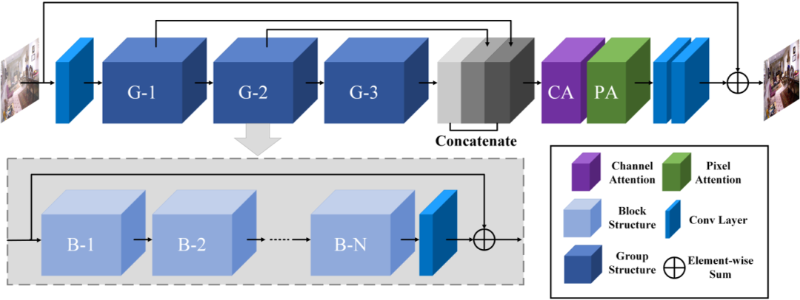
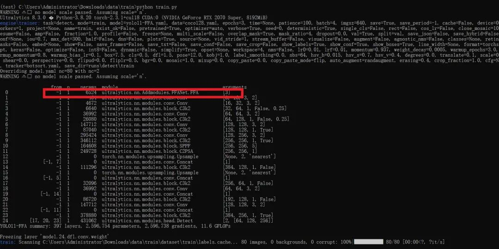

# [yolov11 Improvement Series] Python Source Code + Training Source Code for Feature Fusion Attention Network (FFA-Net) Based on yolov11

[FFA-Net Introduction]

The FFA-net proposed by Peking University and Beijing Jiaotong University: Feature Fusion Attention Network for Single Image Dehazing, an image enhancement dehazing network. The main idea of this network is to directly restore the hazy images using the feature fusion attention network (FFA-Net). Through the innovative design of the feature attention mechanism and the feature fusion attention structure, FFA-Net effectively improves the performance of single image dehazing technology. By cleverly combining channel and pixel attention, as well as local residual learning, the network can more accurately process different areas of haze, achieving significant improvements in detail preservation and color fidelity.

The main idea of FFA-Net is to directly restore the dewdropped images using a feature fusion attention network. This architecture achieves efficient image dehazing through three key components:

1. Feature Attention (FA) module: This combines the Channel Attention and Pixel Attention mechanisms, as different channels contain completely distinct weighted information, and the distribution of fog is uneven across different image pixels. FA provides additional flexibility in handling different types of information by treating different features and pixels unequally, thereby expanding the representational capabilities of convolutional neural networks.

2. Basic Block Structure: Incluses Local Residual Learning and Feature Attention. Local Residual Learning allows less important information such as light fog regions or low frequency to bypass through multiple local residual connections, allowing the main network architecture to focus on more effective information.

3. Attention-based Differentially Feature Fusion (FFA) Structure: The structure adaptively learns feature weights through the feature attention (FA) module, giving more weight to important features. This structure can also preserve shallow information and pass it to deeper layers.

Personal Summary:
The FFA-Net effectively enhances the performance of single image dehazing technology through its innovative design of feature attention mechanism and feature fusion attention structure. By cleverly integrating channel and pixel attention, as well as local residual learning, the network can more precisely handle haze in different regions, achieving significant improvements in detail preservation and color fidelity.

FFA - Net network structure

 Edit

[Introduction to YOLOv11 Framework]

On September 30, 2024, Ultralytics officially released YOLOv11 during its event YOLOVision. YOLOv11 is the latest version of YOLO, developed by the team from both the United States and Spain, Ultralytics. YOLO stands for You Only Look Once, a computer vision algorithm used in image-based artificial intelligence.

### Ultralytics YOLO11 Overview

YOLO11 is the latest version of the Ultralytics YOLO series of real-time object detectors, redefining possibilities with cutting-edge precision, speed, and efficiency. Building on impressive advancements from previous YOLO versions, YOLO11 introduces significant improvements in architecture and training methods, making it a versatile choice for various computer vision tasks.


Editor

Key Features

-

-

Enhanced feature extraction: YOLO11 employs an improved backbone and neck architecture, enhancing feature extraction capabilities to achieve more precise object detection and complex task performance.

-

-

Optimization for efficiency and speed: YOLO11 introduces refined architecture design and optimized training pipelines, providing faster processing speeds while maintaining the best balance between accuracy and performance.

-

-

Achieving higher accuracy with fewer parameters: With the advancement of model design, YOLOv11m has achieved higher average precision (mAP) on the COCO dataset while using 22% fewer parameters than YOLOv8m, thereby improving computational efficiency without compromising accuracy.

-

-

Cross-environment adaptability: YOLO11 can be seamlessly deployed in various environments, including edge devices, cloud platforms, and systems supporting NVIDIA GPUs, ensuring maximum flexibility.

-

-

Supports a wide range of tasks: whether it's object detection, instance segmentation, image classification, pose estimation, or Oriented Object Detection (OBB), YOLO11 aims to tackle various computer vision challenges.


Compared to previous versions, what are the key improvements in Ultralytics YOLO11?

Ultralytics YOLO11 introduces several significant improvements compared to its predecessor. The main improvements include:

-

-

Enhanced feature extraction: YOLO11 employs an improved backbone and neck architecture, enhancing feature extraction capabilities to achieve more precise object detection.

-

-

Optimized efficiency and speed: Precise architectural design and optimized training pipelines provide faster processing speeds while maintaining a balance between accuracy and performance.

-

-

Achieving higher accuracy with fewer parameters: YOLOv11m achieves higher average precision (mAP) on the COCO dataset, reducing its parameters by 22% compared to YOLOv8m, while improving computational efficiency without compromising accuracy.

-

-

Cross-environment adaptability: YOLO11 can be deployed across various environments, including edge devices, cloud platforms, and systems supporting NVIDIA GPUs.

-

-

Supports a wide range of tasks: YOLO11 supports various computer vision tasks, such as object detection, instance segmentation, image classification, pose estimation, and Oriented Object Detection (OBB).

[Test Environment]

windows10 x64

ultralytics==8.3.0

torch==2.3.1

[Improvement Process]

1. Add a new module for FFANet.py (the code is too extensive, please refer to the improved steps in the docx file for the core module source code). Then create a __init__.py file under the same directory and write the code.

from .FFANet import *

#### 2. File modification steps

**Modify tasks.py file**

**Create Model Configuration File**

The content of yolo11-FFA.yaml is as follows:

```
# Ultralytics YOLO 🚀, AGPL-3.0 license
# YOLO11 object detection model with P3-P5 outputs. For Usage examples see https://docs.ultralytics.com/tasks/detect
# Parameters
nc: 80 # number of classes
scales: # model compound scaling constants, i.e. 'model=yolo11n.yaml' will call yolo11.yaml with scale 'n'
  # [depth, width, max_channels]
  n: [0.50, 0.25, 1024] # summary: 319 layers, 2624080 parameters, 2624064 gradients, 6.6 GFLOPs
  s: [0.50, 0.50, 1024] # summary: 319 layers, 9458752 parameters, 9458736 gradients, 21.7 GFLOPs
  m: [0.50, 1.00, 512] # summary: 409 layers, 20114688 parameters, 20114672 gradients, 68.5 GFLOPs
  l: [1.00, 1.00, 512] # summary: 631 layers, 25372160 parameters, 25372144 gradients, 87.6 GFLOPs
  x: [1.00, 1.50, 512] # summary: 631 layers, 56966176 parameters, 56966160 gradients, 196.0 GFLOPs
# YOLO11n backbone
backbone:
  # [from, repeats, module, args]
  - [-1, 1, FFA, []] # 0-P1/2
  - [-1, 1, Conv, [64, 3, 2]] # 1-P1/2
  - [-1, 1, Conv, [128, 3, 2]] # 2-P2/4
  - [-1, 2, C3k2, [256, False, 0.25]]
  - [-1, 1, Conv, [256, 3, 2]] # 4-P3/8
  - [-1, 2, C3k2, [512, False, 0.25]]
  - [-1, 1, Conv, [512, 3, 2]] # 6-P4/16
  - [-1, 2, C3k2, [512, True]]
  - [-1, 1, Conv, [1024, 3, 2]] # 8-P5/32
  - [-1, 2, C3k2, [1024, True]]
  - [-1, 1, SPPF, [1024, 5]] # 10
  - [-1, 2, C2PSA, [1024]] # 11
# YOLO11n head
head:
  - [-1, 1, nn.Upsample, [None, 2, "nearest"]]
  - [[-1, 7], 1, Concat, [1]] # cat backbone P4
  - [-1, 2, C3k2, [512, False]] # 14
  - [-1, 1, nn.Upsample, [None, 2, "nearest"]]
  - [[-1, 5], 1, Concat, [1]] # cat backbone P3
  - [-1, 2, C3k2, [256, False]] # 17 (P3/8-small)
  - [-1, 1, Conv, [256, 3, 2]]
  - [[-1, 14], 1, Concat, [1]] # cat head P4
  - [-1, 2, C3k2, [512, False]] # 20 (P4/16-medium)
  - [-1, 1, Conv, [512, 3, 2]]
  - [[-1, 11], 1, Concat, [1]] # cat head P5
  - [-1, 2, C3k2, [1024, True]] # 23 (P5/32-large)
  - [[17, 20, 23], 1, Detect, [nc]] # Detect(P3, P4, P5)

```

#### 3. Verification of integration

Search for the source code of futureflsl/yolo-improve using Git, then use the newly created yaml configuration file to start the training task.

```
from ultralytics import YOLO
if __name__ == '__main__':
    model = YOLO('yolo11-FFA.yaml')  # build from YAML and transfer weights
        # Train the model
    results = model.train(data='coco128.yaml',epochs=100, imgsz=640, batch=8, device=0, workers=1, save=True,resume=False)
```

After successful integration, the training log will display initialization information for the FFA module, indicating that it has been correctly loaded into the model.

 Edit

[Training Instructions]

Step 1: First, install the necessary modules for YOLOv11. You can refer to the installation process of the YOLOv11 framework. Then, uninstall the official version of pip by running `pip uninstall ultralytics`. Finally, install the improved source code by running `pip install .`
Step 2: Place your dataset in a folder named 'dataset' and ensure that the folder names remain unchanged.
Step 3: Open the train.py, coco128.yaml, and model parameters yaml files separately and modify the necessary parameters. Finally, execute `python train.py` to train.

[Provided Files]

```
├── [Official Source Code]ultralytics-8.3.0.zip
├── train/
│   ├── coco128.yaml
│   ├── dataset/
│   │   ├── train/
│   │   │   ├── images/
│   │   │   │   ├── firc_pic_1.jpg
│   │   │   │   ├── firc_pic_10.jpg
│   │   │   │   ├── firc_pic_11.jpg
│   │   │   │   ├── firc_pic_12.jpg
│   │   │   │   ├── firc_pic_13.jpg
│   │   │   ├── labels/
│   │   │   │   ├── classes.txt
│   │   │   │   ├── firc_pic_1.txt
│   │   │   │   ├── firc_pic_10.txt
│   │   │   │   ├── firc_pic_11.txt
│   │   │   │   ├── firc_pic_12.txt
│   │   │   │   ├── firc_pic_13.txt
│   │   └── val/
│   │       ├── images/
│   │       │   ├── firc_pic_100.jpg
│   │       │   ├── firc_pic_81.jpg
│   │       │   ├── firc_pic_82.jpg
│   │       │   ├── firc_pic_83.jpg
│   │       │   ├── firc_pic_84.jpg
│   │       ├── labels/
│   │       │   ├── firc_pic_100.txt
│   │       │   ├── firc_pic_81.txt
│   │       │   ├── firc_pic_82.txt
│   │       │   ├── firc_pic_83.txt
│   │       │   ├── firc_pic_84.txt
│   ├── train.py
│   ├── yolo11-FFA.yaml
└── training_notes.txt
├── [Improved Source Code]ultralytics-8.3.0.zip
├── Improvement Principles.docx
└── Improved Process.docx
```

[Common Issues Summary]
Question: Why does the map of my model's epoch display as 0 or have very low accuracy?
Answer: Due to the source code being improved, it is not possible to directly fine-tune from the official model. Instead, training from scratch is required, which will result in weaker learning of features and requires many epochs for effects to emerge. Moreover, since the improved source code framework may not necessarily guarantee surpassing the official accuracy, there is also a possibility of achieving far worse results or even very low precision. This indicates that the improved framework does not yield good results. Therefore, for framework improvements, it merely provides a viable solution. Whether the improvements can lead to excellent performance still needs to be confirmed based on actual training conditions. Of course, this does not rule out the possibility of dataset issues, such as a single dataset, unbalanced sample distribution, limited generalization scenarios, poor annotation quality, and small detection targets among other reasons.
[Important Notice]
We only offer one improvement framework solution, and we do not guarantee that it will achieve excellent training accuracy or even surpass the accuracy of official models. The improvement framework is actually a complex process including the feasibility of the framework principle, whether the training dataset is appropriate, the need for back-propagation validation, as well as the comparison of parameter results from similar frameworks. This is a very complex and lengthy process.


## Payment

Here is a pay link on Stripe ( https://buy.stripe.com/3cs8yP7sY87d0vu9AB ). Please contact me lonlonago@foxmail.com after funding $89, and I will send you a complete data files , thank you!


